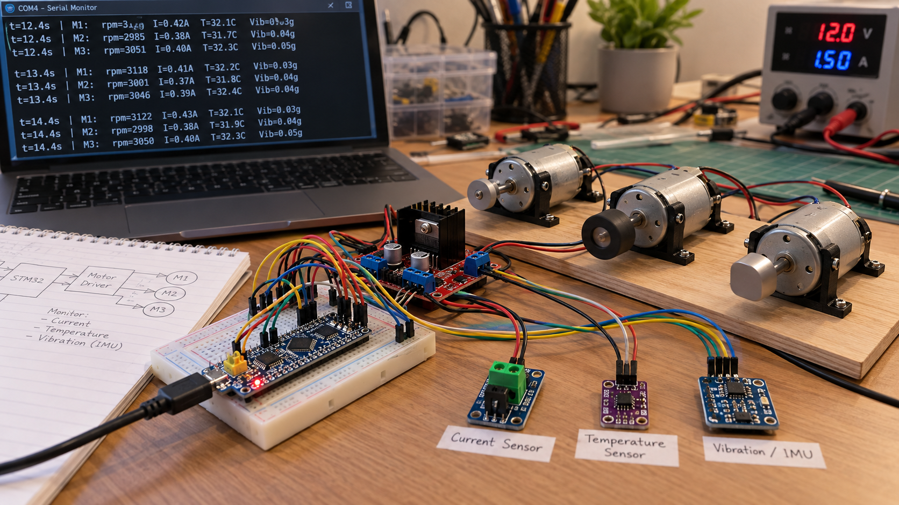
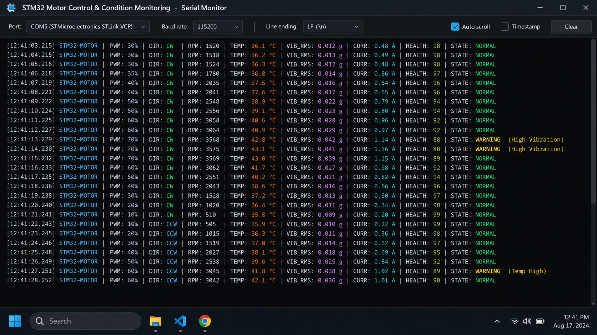
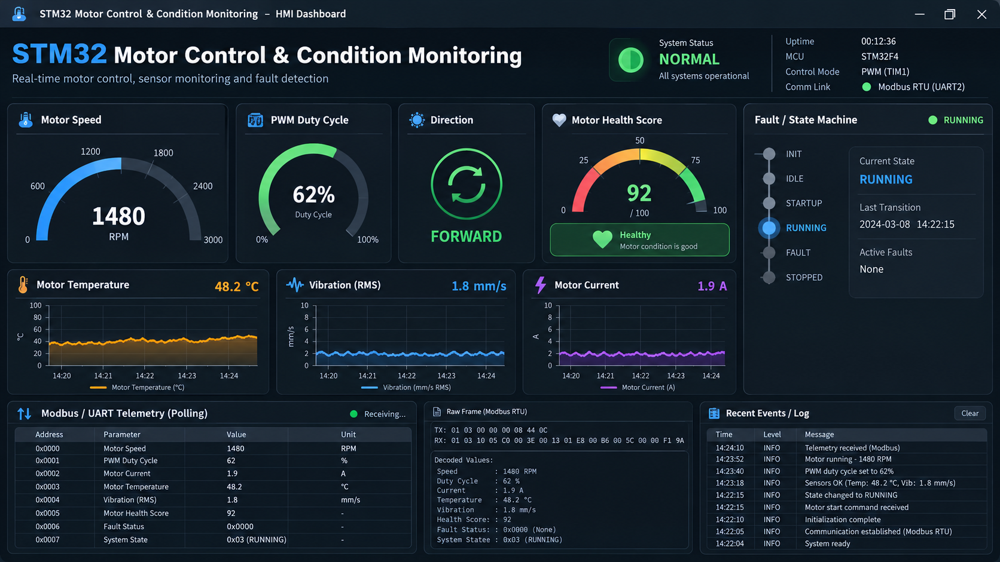
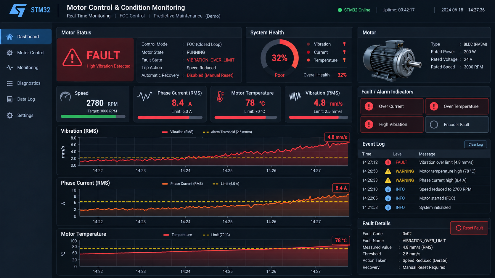

# STM32 Motor Control & Condition Monitoring

**Pradip Sapkota**

A GitHub-ready portfolio project that combines **PWM-based STM32 motor control** with a **condition-monitoring and diagnostics layer** for embedded firmware demonstrations. The project brings together three-motor PWM control, direction reversal, sensor-oriented health monitoring, fault-state logic, and UART / Modbus-style telemetry concepts.

> **Note on demo media:** the original demo photos/videos were lost, so the images in `screenshots/` are **generated illustrative demo outputs** created for portfolio presentation. They show the intended workflow and output style rather than claim to be the original hardware-demo captures.

## Project Summary

This combined project reflects the kind of work described on my resume:

- STM32-based embedded motor control using **PWM timers** and GPIO direction control
- Multi-motor speed ramping and forward / reverse operation
- Condition-monitoring concepts using **temperature**, **vibration**, and **motor current** inputs
- Motor-health scoring and **fault-state machine** logic
- UART telemetry and a **Modbus-style register map** suitable for PLC/HMI integration
- Industrial embedded-firmware structure organized into reusable modules

## What Is Included

### 1) STM32CubeIDE Motor-Control Base
The uploaded CubeIDE project provides an actual STM32F103C8T6 motor-control example using:

- **TIM1 CH2** on **PA9**
- **TIM2 CH1** on **PA0**
- **TIM3 CH1** on **PA6**
- Direction GPIOs on **PA11**, **PA12**, and **PA13**
- PWM period of **999 counts** for duty-cycle control
- Forward/reverse switching with ramp-up and ramp-down profiles

### 2) Combined Condition-Monitoring App Layer
This repository adds an original, reusable application layer under `firmware/App/` that demonstrates how the motor-control base can be extended with:

- filtered sensor acquisition model
- health-score calculation
- warning / fault / recovery state logic
- telemetry formatting
- holding-register image for Modbus-style transport
- a small synthetic-sensor generator for validation/demo flows

## System Architecture

```text
           +------------------------------+
           |  STM32F103C8T6 MCU           |
           |  TIM1 / TIM2 / TIM3 PWM      |
           +--------------+---------------+
                          |
                  PWM + Direction Control
                          |
                          v
                 +-------------------+
                 |  Motor Driver      |
                 +---------+---------+
                           |
           +---------------+----------------+
           |               |                |
           v               v                v
         Motor 1         Motor 2          Motor 3

 Sensors / Diagnostics Path:

 Temperature  ----+
 Vibration    ----+--> Filtering --> Health Score --> Fault FSM --> UART / Modbus Registers
 Current      ----+
```

## Demo Gallery

### Testbench-style project demo


### UART / serial telemetry output


### Monitoring dashboard — normal state


### Monitoring dashboard — fault state


## Repository Structure

```text
Pradip_STM32_Motor_Control_Condition_Monitoring/
├── README.md
├── NOTICE.md
├── .gitignore
├── docs/
│   ├── SYSTEM_OVERVIEW.md
│   ├── PIN_MAP_AND_PERIPHERALS.md
│   ├── CONDITION_MONITORING.md
│   ├── TELEMETRY_AND_MODBUS.md
│   └── DEMO_MEDIA.md
├── firmware/
│   ├── cubeide_project/
│   │   ├── Motor_Control.ioc
│   │   ├── Src/main.c
│   │   ├── main.h
│   │   └── LICENSE
│   └── App/
│       ├── Inc/
│       ├── Src/
│       └── README.md
├── screenshots/
│   ├── 01_testbench_demo.png
│   ├── 02_uart_telemetry.png
│   ├── 03_dashboard_normal.png
│   └── 04_dashboard_fault.png
├── demo/
│   └── README.md
└── third_party/
    └── Motor_Control_MIT_License.txt
```

## Embedded Features Demonstrated

### Motor Control
- PWM generation using STM32 timers
- duty-cycle scaling from 0% to 100%
- direction control via GPIO outputs
- ramp-up / ramp-down sequencing
- multi-motor synchronization concepts

### Condition Monitoring
- monitoring variables for **temperature**, **vibration RMS**, and **motor current**
- configurable warning and fault thresholds
- weighted motor health score (0–100)
- persistence-based fault handling to reduce false trips
- NORMAL / WARNING / FAULT / RECOVERY state transitions

### Industrial Communication Concepts
- UART telemetry formatting for debug/monitoring
- Modbus-style holding-register map
- field-facing values scaled for transport (°C ×10, vibration ×100, current ×10)
- ready to integrate with PC tools, PLCs, or HMIs

## Quick Technical Notes

### PWM / MCU details grounded in the uploaded CubeIDE project
- **MCU:** STM32F103C8T6
- **TIM1 Prescaler / Period:** 71 / 999
- **Direction outputs:** PA11, PA12, PA13
- **Main PWM outputs:** PA9, PA0, PA6

### Example condition-monitoring thresholds used in the app layer
- Temperature warning / fault: **55 °C / 70 °C**
- Vibration warning / fault: **2.5 / 4.0** (RMS engineering units)
- Current warning / fault: **2.0 A / 3.0 A**

## Suggested Next Hardware Extensions

If you want to continue this project later, the most natural upgrades would be:

- ADC-based current sensing
- encoder or Hall-feedback RPM measurement
- UART DMA logging
- RS-485 transceiver integration for true Modbus RTU
- external temperature and IMU drivers over I2C/SPI
- fault-based motor derating or shutdown logic
- PCB design for a dedicated embedded node

## Author

**Pradip Sapkota**  
Computer Engineering  
Minnesota State University, Mankato
